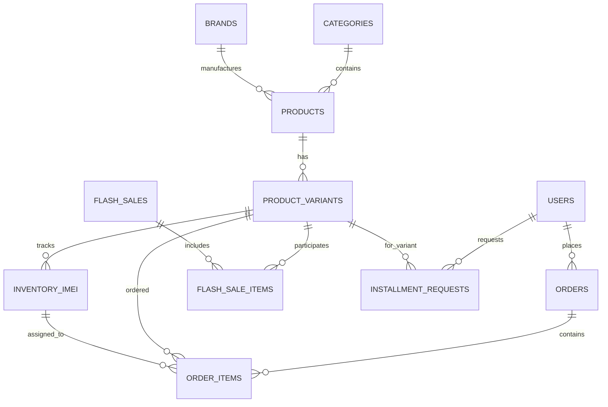

# THIẾT KẾ CƠ SỞ DỮ LIỆU (DATABASE SCHEMA DESIGN)
## HỆ THỐNG BÁN LẺ ĐIỆN THOẠI & THIẾT BỊ CÔNG NGHỆ

Hệ thống sử dụng **PostgreSQL** kết hợp với **Prisma ORM**. 
Mô hình hỗ trợ: Sản phẩm đa biến thể (Multi-variants), Thông số kỹ thuật động (Dynamic Specs), Quản lý từng mã IMEI/Serial, Đơn hàng, Flash Sale, và Đăng ký trả góp.

---

## 1. SƠ ĐỒ THỰC THỂ QUAN HỆ (ERD DIAGRAM)

---

## 2. ĐẶC TẢ CHI TIẾT CÁC BẢNG CƠ SỞ DỮ LIỆU

### 2.1. Nhóm Bảng Danh Mục & Thương Hiệu
* `Category`:
  * `id`: Int / UUID (Khóa chính)
  * `name`: String (VD: "Điện thoại", "Laptop", "Phụ kiện")
  * `slug`: String (Unique, VD: "dien-thoai")
  * `icon`: String (URL hoặc tên icon)
  * `parentId`: Int (Cho phép danh mục đa cấp)
  * `order`: Int (Thứ tự hiển thị trên menu)
  * `isActive`: Boolean

* `Brand`:
  * `id`: Int / UUID
  * `name`: String (VD: "Apple", "Samsung", "Xiaomi", "OPPO")
  * `slug`: String (Unique, VD: "apple")
  * `logo`: String (URL ảnh logo)
  * `isActive`: Boolean

---

### 2.2. Nhóm Bảng Sản Phẩm & Biến Thể (Core Product Catalog)

* `Product` (Sản phẩm cha / Master Product):
  * `id`: String / UUID
  * `name`: String (VD: "iPhone 16 Pro Max")
  * `slug`: String (Unique, VD: "iphone-16-pro-max")
  * `categoryId`: Int (FK -> Category)
  * `brandId`: Int (FK -> Brand)
  * `thumbnail`: String (Ảnh đại diện chính)
  * `images`: String[] (Mảng link album ảnh)
  * `description`: Text (Bài viết đánh giá chi tiết chuẩn SEO)
  * `highlights`: String[] (Các điểm nổi bật: "Chip A18 Pro", "Camera 48MP")
  * `specs`: JSONB (Cấu trúc thông số kỹ thuật động: RAM, Màn hình, Dung lượng pin, Công nghệ sạc, Camera...)
  * `warrantyMonths`: Int (Mặc định 12 tháng)
  * `isFeatured`: Boolean (Hiển thị trang chủ)
  * `isActive`: Boolean
  * `createdAt`, `updatedAt`

* `ProductVariant` (Biến thể cấu hình & màu sắc):
  * `id`: String / UUID
  * `productId`: String (FK -> Product)
  * `sku`: String (Unique, VD: "IP16PM-256-DESERT")
  * `colorName`: String (VD: "Titan Sa Mạc", "Titan Tự Nhiên", "Titan Đen")
  * `colorCode`: String (Mã màu HEX: `#C5B49E` để hiển thị nút tròn chọn màu)
  * `storage`: String (VD: "128GB", "256GB", "512GB", "1TB")
  * `originalPrice`: Decimal (Giá niêm yết của hãng, VD: 34.990.000)
  * `salePrice`: Decimal (Giá bán thực tế tại shop, VD: 32.490.000)
  * `costPrice`: Decimal (Giá vốn nhập hàng - chỉ Admin/Kế toán xem được)
  * `image`: String (Ảnh sản phẩm theo đúng màu sắc đó)
  * `stockQuantity`: Int (Tổng số lượng tồn kho tự động tính từ bảng IMEI)
  * `isActive`: Boolean

---

### 2.3. Nhóm Bảng Quản Lý Kho & Mã IMEI/Serial (Đặc thù Thế Giới Di Động)

* `InventoryIMEI` (Mỗi bản ghi đại diện cho 1 máy vật lý):
  * `id`: String / UUID
  * `variantId`: String (FK -> ProductVariant)
  * `imei`: String (Unique, Mã IMEI gồm 15 chữ số hoặc Serial Number)
  * `status`: Enum (`IN_STOCK` - Trong kho, `SOLD` - Đã bán, `DEFECTIVE` - Lỗi chờ đổi trả, `WARRANTY` - Đang bảo hành)
  * `storeLocation`: String (Vị trí kho hoặc chi nhánh: "Kho Tổng Hà Nội", "Kho TP.HCM")
  * `importDate`: DateTime (Ngày nhập kho)
  * `soldDate`: DateTime (Ngày xuất bán cho khách)
  * `orderId`: String (FK -> Order, gán mã đơn khi xuất kho)

---

### 2.4. Nhóm Bảng Đơn Hàng & Chi Tiết Đơn Hàng

* `Order`:
  * `id`: String / UUID
  * `orderCode`: String (Unique, VD: "TGDD-20261110-8921")
  * `userId`: String (FK -> User, cho phép null nếu khách mua không cần tài khoản)
  * `customerName`: String (Họ và tên khách)
  * `customerPhone`: String (SĐT khách nhận hàng)
  * `customerEmail`: String (Email nhận hóa đơn điện tử)
  * `deliveryMethod`: Enum (`HOME_DELIVERY` - Giao tận nơi, `STORE_PICKUP` - Nhận tại cửa hàng)
  * `shippingAddress`: String (Địa chỉ giao chi tiết)
  * `city`, `district`, `ward`: String (Tỉnh/Thành, Quận/Huyện, Phường/Xã)
  * `pickupStore`: String (Tên chi nhánh nếu nhận tại shop)
  * `paymentMethod`: Enum (`COD`, `VIETQR`, `VNPAY`, `MOMO`, `INSTALLMENT_CREDIT`, `INSTALLMENT_FINANCE`)
  * `paymentStatus`: Enum (`PENDING`, `PAID`, `REFUNDED`, `FAILED`)
  * `orderStatus`: Enum (`PENDING` - Chờ xác nhận, `CONFIRMED` - Đã xác nhận, `PREPARING` - Đang xuất kho gán IMEI, `SHIPPING` - Đang giao, `COMPLETED` - Đã giao, `CANCELLED` - Đã hủy)
  * `subTotal`: Decimal (Tổng tiền hàng)
  * `discountAmount`: Decimal (Số tiền giảm giá voucher)
  * `shippingFee`: Decimal (Phí vận chuyển)
  * `totalAmount`: Decimal (Tổng tiền thanh toán cuối cùng)
  * `notes`: Text (Ghi chú: xuất VAT, yêu cầu gọi trước khi giao...)
  * `createdAt`, `updatedAt`

* `OrderItem`:
  * `id`: String / UUID
  * `orderId`: String (FK -> Order)
  * `variantId`: String (FK -> ProductVariant)
  * `productName`: String (Lưu snapshot tên máy tại thời điểm mua)
  * `variantName`: String (Lưu snapshot màu sắc/dung lượng)
  * `price`: Decimal (Đơn giá tại thời điểm mua)
  * `quantity`: Int (Số lượng)
  * `assignedImei`: String (Lưu mã IMEI được nhân viên quét gán cho đơn hàng)

---

### 2.5. Nhóm Bảng Khuyến Mãi & Trả Góp

* `FlashSale`:
  * `id`: String / UUID
  * `title`: String (VD: "Flash Sale 12.12 - Đón Tết Công Nghệ")
  * `startTime`: DateTime
  * `endTime`: DateTime
  * `isActive`: Boolean

* `FlashSaleItem`:
  * `id`: String / UUID
  * `flashSaleId`: String (FK -> FlashSale)
  * `variantId`: String (FK -> ProductVariant)
  * `salePrice`: Decimal (Giá flash sale đặc biệt)
  * `saleQuantity`: Int (Số lượng suất sale giới hạn)
  * `soldQuantity`: Int (Số lượng suất đã bán)

* `InstallmentRequest` (Đơn đăng ký mua trả góp):
  * `id`: String / UUID
  * `requestCode`: String (Unique)
  * `variantId`: String (FK -> ProductVariant)
  * `fullName`: String
  * `phoneNumber`: String
  * `idCardNumber`: String (Số CCCD)
  * `financialCompany`: Enum (`HOME_CREDIT`, `FE_CREDIT`, `HD_SAISON`, `CREDIT_CARD`)
  * `prepaidPercent`: Int (Tỷ lệ trả trước: 0%, 20%, 30%...)
  * `termMonths`: Int (Kỳ hạn: 6, 9, 12 tháng)
  * `monthlyPayment`: Decimal (Số tiền trả mỗi tháng)
  * `status`: Enum (`PENDING_REVIEW`, `APPROVED`, `REJECTED`, `CONVERTED_TO_ORDER`)
  * `adminNote`: String (Ghi chú của nhân viên thẩm định)
  * `createdAt`: DateTime

---

### 2.6. Nhóm Bảng Người Dùng & Phân Quyền (RBAC)

* `User`:
  * `id`: String / UUID
  * `name`: String
  * `phone`: String (Unique)
  * `email`: String (Unique, optional)
  * `password`: String (Hashed with bcrypt)
  * `role`: Enum (`CUSTOMER`, `SALE_STAFF`, `WAREHOUSE_STAFF`, `ADMIN`, `SUPER_ADMIN`)
  * `loyaltyPoints`: Int (Điểm tích lũy thành viên)
  * `membershipRank`: Enum (`BRONZE`, `SILVER`, `GOLD`, `DIAMOND`)
  * `isActive`: Boolean
  * `createdAt`: DateTime
