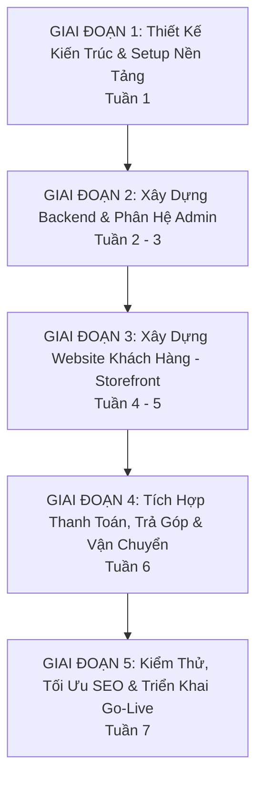

# KẾ HOẠCH TRIỂN KHAI DỰ ÁN (PROJECT IMPLEMENTATION PLAN)
## WEBSITE BÁN LẺ ĐIỆN THOẠI & THIẾT BỊ CÔNG NGHỆ (MÔ HÌNH THẾ GIỚI DI ĐỘNG)

---

## 1. TỔNG QUAN HIỆN TRẠNG & MỤC TIÊU NGAY LÚC NÀY

* **Hiện trạng:** Đã hoàn thành bản đặc tả yêu cầu phần mềm ([SRS_Website_BanDienThoai.md](file:///c:/Users/admin/OneDrive/Thành/Bán%20Điện%20Thoại/SRS_Website_BanDienThoai.md)).
* **Mục tiêu tiếp theo:** Chuyển từ đặc tả (Requirements) sang **Hành động kỹ thuật (Engineering Execution)** một cách có hệ thống, tránh làm lan man hoặc phải đập đi xây lại cơ sở dữ liệu.

---

## 2. LỘ TRÌNH 5 GIAI ĐOẠN CHI TIẾT



---

### GIAI ĐOẠN 1: THIẾT KẾ KIẾN TRÚC & SETUP NỀN TẢNG (TUẦN 1 - BẮT BUỘC LÀM TRƯỚC)
> **Mục tiêu:** Định hình khung kỹ thuật, thiết kế cấu trúc database chính xác để quản lý biến thể và mã IMEI.

* [ ] **Bước 1.1: Chốt kiến trúc mã nguồn (Repository Architecture)**
  * Lựa chọn cấu trúc: **Monorepo** (khuyên dùng, dễ đồng bộ code giữa Admin, Client và Backend) hoặc **Multi-repo**.
  * Cấu trúc đề xuất:
    ```text
    ban-dien-thoai/
    ├── apps/
    │   ├── web-client/     # Next.js 14+ (Website khách hàng - chuẩn SEO)
    │   ├── web-admin/      # React + Ant Design / Shadcn (Giao diện quản lý)
    │   └── backend-api/    # NestJS / Node.js Express (REST API / GraphQL)
    ├── packages/
    │   ├── database/       # Prisma ORM / Migrations schema
    │   └── shared-types/   # TypeScript interfaces dùng chung (Product, Order, User...)
    └── docs/               # Tài liệu SRS, ERD, API specs
    ```

* [ ] **Bước 1.2: Thiết kế chi tiết Cơ sở dữ liệu (Database Schema / ERD)**
  * Lập sơ đồ quan hệ:
    * `Category` -> `Brand` -> `Product` (Master)
    * `Product` -> `ProductVariant` (Màu sắc, Dung lượng, Giá bán, Giá vốn)
    * `ProductVariant` -> `Inventory_Serial_IMEI` (Mỗi máy một mã IMEI duy nhất)
    * `Order` -> `OrderItem` -> `Assigned_IMEI`
    * `InstallmentRequest` (Hồ sơ trả góp)
  * Khởi tạo Prisma Schema / SQL migration scripts ban đầu.

* [ ] **Bước 1.3: Cài đặt môi trường phát triển (Dev Environment Setup)**
  * Cấu hình Docker Compose: Chạy PostgreSQL, Redis, Meilisearch (công cụ tìm kiếm).
  * Cấu hình ESLint, Prettier, Git hooks (Husky).

---

### GIAI ĐOẠN 2: PHÁT TRIỂN CORE BACKEND & PHÂN HỆ QUẢN TRỊ ADMIN (TUẦN 2 - 3)
> **Mục tiêu:** Phải có hệ thống quản lý để nhập dữ liệu điện thoại, cấu hình danh mục, quản lý kho IMEI trước khi làm giao diện cho khách hàng.

* [ ] **Bước 2.1: Module Xác thực & Phân quyền (Auth & RBAC)**
  * Đăng nhập JWT, cơ chế Refresh Token cho Admin và Nhân viên.
  * Phân quyền: Super Admin, Quản lý kho, Nhân viên bán hàng, CSKH.

* [ ] **Bước 2.2: Quản lý Danh mục, Hãng & Thuộc tính kỹ thuật (Catalog Management)**
  * CRUD Danh mục: Điện thoại, Phụ kiện, Tablet...
  * CRUD Hãng: Apple, Samsung, Xiaomi, OPPO...
  * Bộ thông số kỹ thuật động (Dynamic Specs): Chipset, RAM, Màn hình, Pin, Công nghệ sạc.

* [ ] **Bước 2.3: Quản lý Sản phẩm biến thể & Nhập kho IMEI**
  * Giao diện thêm sản phẩm Master + Tổ hợp biến thể (VD: iPhone 16 Pro Max x 256GB/512GB/1TB x 4 Màu).
  * Chức năng nhập kho danh sách số IMEI theo file Excel.
  * Xem trạng thái tồn kho thực tế của từng mã IMEI.

* [ ] **Bước 2.4: Module Xử lý Đơn hàng (Order Processing)**
  * Bảng tiếp nhận đơn hàng theo thời gian thực (Websocket / Polling).
  * Thao tác: Duyệt đơn -> Quét mã vạch IMEI gán vào đơn -> Đóng gói -> In phiếu gửi hàng.

---

### GIAI ĐOẠN 3: PHÁT TRIỂN PHÂN HỆ KHÁCH HÀNG - STOREFRONT (TUẦN 4 - 5)
> **Mục tiêu:** Xây dựng giao diện mua sắm hiện đại, tốc độ cao, tối ưu hiển thị trên điện thoại (Mobile-first).

* [ ] **Bước 3.1: Trang chủ & Điều hướng (Homepage & Navigation)**
  * Header với thanh tìm kiếm thông minh (gợi ý nhanh sản phẩm kèm ảnh và giá).
  * Menu ngành hàng theo hãng, Mega-menu giống Thegioididong.
  * Banner khuyến mãi, Carousel sự kiện ra mắt.
  * Khối Flash Sale với đồng hồ đếm ngược và thanh % số lượng đã bán.

* [ ] **Bước 3.2: Bộ lọc thông minh & So sánh sản phẩm**
  * Bộ lọc đa tiêu chí: Hãng, mức giá, RAM, bộ nhớ trong, tính năng (sạc nhanh, chống nước, camera zoom...).
  * Giao diện so sánh 2-3 sản phẩm song song (thông số kỹ thuật, chênh lệch giá).

* [ ] **Bước 3.3: Trang chi tiết sản phẩm (PDP - Product Detail Page)**
  * Trình chiếu hình ảnh/video sản phẩm, xem ảnh theo màu được chọn.
  * Bộ chọn phiên bản (bấm đổi dung lượng -> giá và tồn kho đổi theo tức thì).
  * Khối khuyến mãi: Quà tặng kèm, giảm giá phụ kiện mua cùng.
  * Bảng thông số kỹ thuật rút gọn + Popup chi tiết.
  * Nút CTA: `MUA NGAY`, `TRẢ GÓP 0%`, `THÊM GIỎ HÀNG`.
  * Khối Đánh giá & Hỏi đáp bình luận.

* [ ] **Bước 3.4: Giỏ hàng & Luồng đặt hàng (Cart & Checkout)**
  * Tối ưu checkout 1 trang (One-step Checkout): Nhập Họ tên + SĐT + Địa chỉ.
  * Chọn hình thức: Giao tận nơi hoặc nhận tại cửa hàng gần nhất.
  * Áp mã giảm giá (Coupon).

---

### GIAI ĐOẠN 4: NGHIỆP VỤ NÂNG CAO - THANH TOÁN, TRẢ GÓP & VẬN CHUYỂN (TUẦN 6)
> **Mục tiêu:** Hoàn thiện các nghiệp vụ đặc thù biến website thành một hệ thống bán lẻ chuyên nghiệp thực thụ.

* [ ] **Bước 4.1: Tích hợp Cổng thanh toán trực tuyến**
  * Tích hợp VietQR (tạo mã QR động chứa sẵn số tiền và mã đơn hàng, tự động xác nhận khi khách chuyển khoản).
  * Tích hợp cổng VNPAY / MoMo.

* [ ] **Bước 4.2: Phân hệ Mua Trả Góp (Đặc thù Thế Giới Di Động)**
  * Bảng tính trả góp tự động: Khách chọn % trả trước (0% - 70%), kỳ hạn (6 - 12 tháng) -> Hệ thống tự tính số tiền trả góp hàng tháng.
  * Form đăng ký duyệt hồ sơ online (CCCD, thông tin cơ bản) gửi về Admin để nhân viên tài chính liên hệ.

* [ ] **Bước 4.3: Tích hợp Đơn vị vận chuyển & Tra cứu đơn**
  * Kết nối API đơn vị vận chuyển (GHN / GHTK) để tự động tính phí ship và đẩy đơn tự động.
  * Trang tra cứu trạng thái đơn hàng chỉ cần nhập SĐT + Mã đơn.
  * Trang tra cứu bảo hành điện tử theo số IMEI.

---

### GIAI ĐOẠN 5: KIỂM THỬ, TỐI ƯU SEO & TRIỂN KHAI VẬN HÀNH (TUẦN 7)
> **Mục tiêu:** Đảm bảo hệ thống bảo mật, chạy ổn định, tải nhanh và sẵn sàng kinh doanh.

* [ ] **Bước 5.1: Tối ưu SEO & Tốc độ tải trang**
  * Tối ưu Server-Side Rendering (SSR) trong Next.js.
  * Cấu hình tự động sinh `sitemap.xml`, thẻ Meta, Rich Snippet Schema.org (giá bán, rating).
  * Tối ưu ảnh qua CDN (Next/Image, định dạng WebP/AVIF).
* [ ] **Bước 5.2: Kiểm thử (Testing & QA)**
  * Kiểm thử luồng đặt hàng, trừ tồn kho, nhập xuất IMEI.
  * Kiểm thử chịu tải (Stress test) cho kịch bản Flash Sale.
* [ ] **Bước 5.3: Triển khai máy chủ (Deployment & DevOps)**
  * Frontend: Triển khai trên Vercel hoặc VPS Docker.
  * Backend API & Database: Triển khai trên VPS (Ubuntu, Nginx, Docker, SSL Certbot).
  * Thiết lập cơ chế sao lưu (Backup) tự động hàng ngày.

---

## 3. CHECKLIST VIỆC CẦN LÀM NGAY BÂY GIỜ (ACTIONABLE TODAY)

Để bắt đầu bước đi đầu tiên ngay hôm nay, đây là 3 việc cần quyết định và thực hiện:

### 🎯 Việc 1: Xác nhận lựa chọn Công nghệ (Tech Stack)
* **Website Khách hàng:** Chọn `Next.js 14+` (App Router) + `Tailwind CSS`.
* **Giao diện Quản trị (Admin):** Chọn `React (Vite)` + `Ant Design` (hoặc tích hợp luôn bên trong Next.js route `/admin`).
* **Backend & Database:** Chọn `Node.js (NestJS hoặc Express)` + `PostgreSQL` + `Prisma ORM`.

### 🎯 Việc 2: Khởi tạo Cấu trúc Dự án (Project Scaffolding)
* Tạo các thư mục dự án và khởi tạo file quản lý gói (`package.json`, TypeScript config).
* Khởi tạo dự án Next.js cho giao diện Storefront.

### 🎯 Việc 3: Thiết kế Schema Cơ sở dữ liệu (Prisma / SQL)
* Viết file `schema.prisma` định nghĩa chi tiết bảng: `Product`, `ProductVariant`, `InventoryIMEI`, `Category`, `Brand`, `Order`, `User`.
